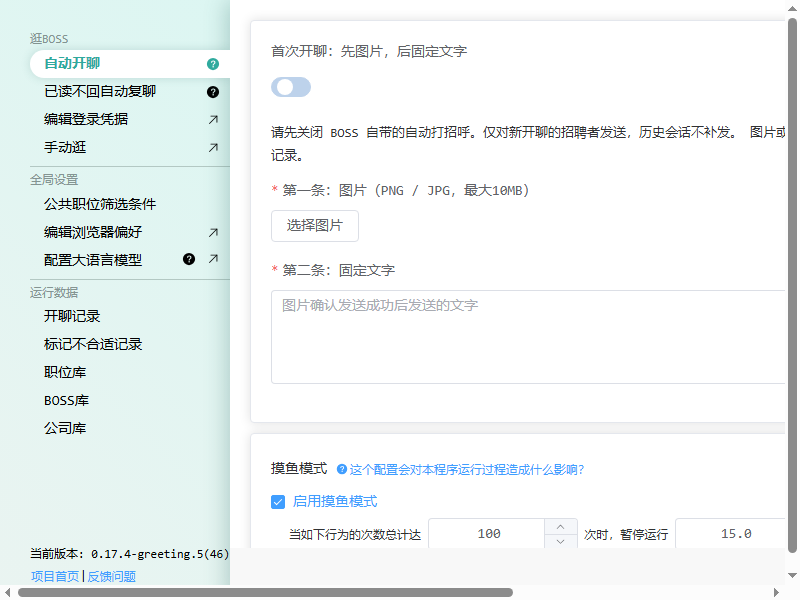
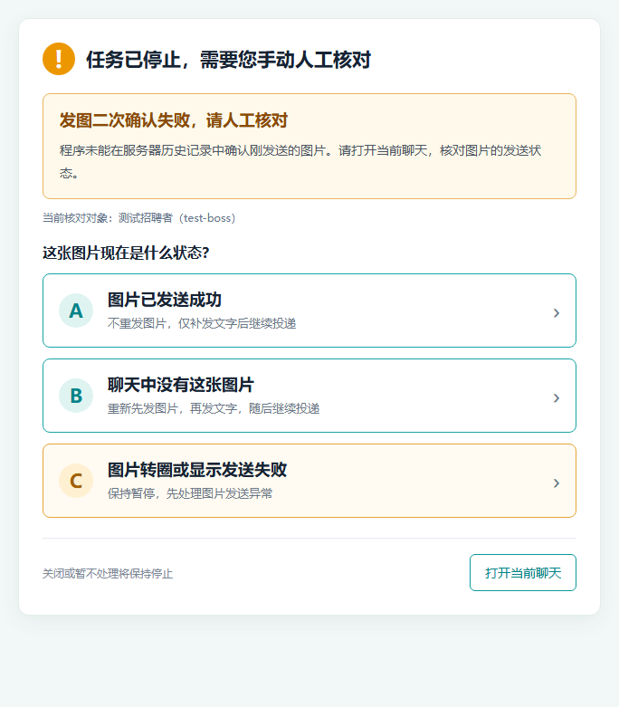
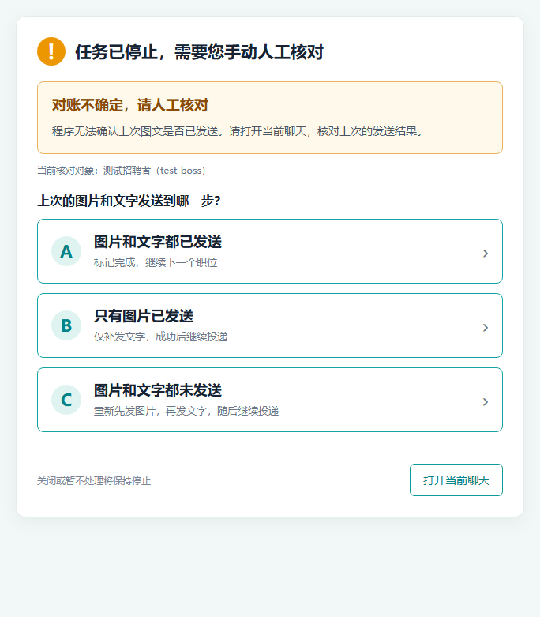

# 牛人快跑「先图后文」二开版

基于 [geekgeekrun/geekgeekrun](https://github.com/geekgeekrun/geekgeekrun) 修改的桌面程序。保留原有职位筛选、自动开聊和运行记录，在首次开聊时增加 **先发送一张图片，再发送固定文字** 的功能，并提供发送结果不确定时的人工核对窗口。

**这是非官方二次开发版本。** 原项目的主体代码、基础功能和原作者贡献来自 GeekGeekRun；本仓库负责说明和维护本分支的改动，与 BOSS 直聘无隶属关系。

当前发布版本：`0.17.4-greeting.5`，界面构建号：`46`。本次提供 **Windows x64 安装包**。

[下载最新版](https://github.com/Onecki/geekgeekrun-image/releases/latest) · [查看全部版本](https://github.com/Onecki/geekgeekrun-image/releases) · [二开改动与验证](docs/CHANGES-GREETING.md) · [原项目 README](docs/README-UPSTREAM.md)

## 先看这里

- **只想使用程序**：到本仓库右侧的 **Releases** 下载以 `setup.exe` 结尾的安装包。GitHub 的 `Code → Download ZIP` 是源码，不能直接双击运行。
- **以前用过牛人快跑**：先备份旧数据，再安装本版。同一台电脑、同一个 Windows 用户下，本版默认沿用原数据目录。
- **刚换电脑**：安装程序不会自动带走旧电脑的投递记录。需要另外迁移数据，操作见下文。
- **使用先图后文前**：先关闭 BOSS 内置的自动打招呼，避免它抢先发送文字。
- **出现人工核对窗口时**：先看实际聊天记录再选按钮，不用打开 JSON 文件改状态。

## 1. 本版增加了什么

| 功能 | 实际效果 |
| --- | --- |
| 首条图片、第二条固定文字 | 新开聊时先上传图片，确认后发送你提前写好的文字 |
| 图片选择和预览 | 支持 PNG / JPG，单张不超过 10 MB |
| 固定文字设置 | 最长 1000 字，可换行 |
| 人工核对窗口 | 对图片确认失败、上次结果不确定分别给出操作选项 |
| 发送进度记录 | 记录图文发送到哪一步，恢复时结合聊天历史检查 |
| 历史会话保护 | 检查本地历史记录，避免对已记录的对象重新走首次发送 |
| 残留任务锁恢复 | 上次进程已经退出时接管遗留锁；仍在运行的任务会阻止并发发送 |
| 独立安装身份 | 本版有自己的安装目录和后台连接，不覆盖官方版的程序目录 |

本次新增的图文流程用于「自动开聊」。原项目的其他功能仍保留；「已读不回自动复聊」有自己的设置，不由这里的图片和固定文字选项控制。

这里常说的“投递”，主要指筛选职位并建立聊天、发送消息。平台上的简历附件、隐私授权等仍按 BOSS 的页面和提示处理。

## 2. 下载和安装

### 第一次安装

1. 打开 [Releases](https://github.com/Onecki/geekgeekrun-image/releases/latest)。
2. 在 **Assets** 里下载 `GeekGeekRun-Greeting-0.17.4-greeting.5-setup.exe`，以后更新时选择对应新版本的 `setup.exe`。
3. 双击安装。默认安装在当前 Windows 用户下，一般不需要管理员权限。
4. 安装完成后，从桌面打开 **GeekGeekRun Image Greeting**。
5. 左下角应显示 `0.17.4-greeting.5(46)`。

普通用户不需要安装 Node.js、Python 或开发环境。程序运行需要可用的浏览器；首次启动如果提示准备、下载或选择浏览器，按程序提示完成即可。

默认程序目录：

```text
%LOCALAPPDATA%\Programs\geekgeekrun-greeting
```

Windows 的 `%LOCALAPPDATA%`、`%USERPROFILE%` 这类路径可以直接粘贴到文件资源管理器地址栏，再按回车。

### 已经安装过本二开版

1. 先停止投递任务，退出本版程序。
2. 备份数据目录，方法见第 7 节。
3. 安装新的 `setup.exe`，覆盖升级即可，通常不必先卸载。
4. 重新打开程序，检查左下角版本号及「开聊记录」。

本版使用独立应用标识。若系统还保留官方版，它可能仍有自己的快捷方式和卸载项；本版桌面入口为 **GeekGeekRun Image Greeting**。

官方版和本版默认共用业务数据目录。使用时只运行其中一个，避免两个程序同时操作聊天或数据库。

## 3. 登录自己的 BOSS 账号

1. 打开程序，点击左侧 **编辑登录凭据**。
2. 在程序打开的浏览器里，按 BOSS 页面提示登录自己的账号。
3. 按登录助手的提示完成凭据保存。回到主窗口后，应看到保存成功的提示。
4. 可以点击左侧 **手动逛**，检查是否进入了正确的账号。

登录失效时，再走一遍这套流程即可。换账号前先停止任务。不要把登录凭据文件上传到 GitHub 或发给其他人。

## 4. 配置先图片、后文字

### 第一步：关闭 BOSS 自带的自动打招呼

到 BOSS 自身的设置里关闭自动打招呼，并检查新会话是否还会自动发出招呼消息。具体入口以你当前客户端的设置为准。

原因很直接：如果平台先发出一段文字，之后再发送图片，图片就不是第一条了。程序检测到已有主动消息时，可能会停止这次首次发送流程。

### 第二步：打开本版的开关

进入左侧 **自动开聊**，页面顶部就是 **首次开聊：先图片，后固定文字**。打开开关后，设置：

- **第一条：图片**：点击「选择图片」，选一张 PNG / JPG，大小不超过 10 MB。程序会保存一份图片副本，后续移动原文件通常不会影响这份副本。
- **第二条：固定文字**：填写图片之后要发送的内容，最多 1000 字。例如：

```text
您好，上面是我的项目介绍。我对这个职位很感兴趣，希望有机会进一步沟通，谢谢。
```

点击页面底部 **仅保存配置**，可以先保存而不启动任务。



### 第三步：设置职位范围

继续在「自动开聊」页面配置职位来源、搜索关键词、城市、工作经验、薪资等条件。公共条件可以在左侧 **公共职位筛选条件** 中设置，具体以页面提供的选项为准。

不确定某项含义时，查看页面旁边的说明或问号提示。首次使用先缩小职位范围，观察实际运行结果。

### 第四步：开始运行

确认账号、图片、文字和职位条件无误后，点击：

**保存配置，并开始求职！**

程序会按原有逻辑筛选职位、建立新会话，再执行下面的图文流程：

```text
核对当前账号和招聘者
        ↓
检查历史记录及已有主动消息
        ↓
发送图片并核对服务器历史
        ↓
发送固定文字并核对服务器历史
        ↓
完成当前对象，继续后面的职位
```

第一次使用建议观察少量对象，确认图片和文字的顺序、内容都符合预期，再扩大范围。需要暂停时，使用程序提供的任务停止操作，等任务停下后再退出。

### 这个开关的作用范围

- 开关关闭时，不启用本次增加的先图后文流程。
- 普通历史会话不会因为打开开关就被批量补发图片。
- 程序自己记录为未完成的图文任务，启动后会先尝试核对，再继续处理新职位。
- 同一轮未完成任务会保留原先固定文字的快照。即使你后来修改设置，补发时仍使用那轮任务保存的文字。

## 5. 出现人工核对窗口怎么办

**看见图片气泡，不一定代表发送成功。** 本地显示、上传状态与服务器历史记录可能暂时不一致。程序遇到无法判断的结果时，会暂停等待你核对，避免直接重复发送。

窗口会显示当前核对对象。先点击 **打开当前聊天**，确认是这个招聘者、这一次的消息，再选择对应情况。

### 情况一：发图二次确认失败，请人工核对

意思是：程序发图后，没有在服务器历史中确认到刚发送的图片。此时重点看这张图片的状态。

| 按钮 | 应该在什么情况下选 | 点击后做什么 |
| --- | --- | --- |
| A：图片已发送成功 | 你已核对，图片确实成功发送，文字还未发送 | 不重发图片，仅补发文字，成功后继续投递 |
| B：聊天中没有这张图片 | 你已核对，这次图片没有发出去 | 重新先发图片，再发文字，随后继续投递 |
| C：图片转圈或显示发送失败 | 图片仍在转圈，或显示发送失败，需要先处理异常 | 保持停止，不自动重试 |



### 情况二：对账不确定，请人工核对

意思是：程序检查上一次未完成的记录时，无法自动判断整套图文到底发到哪一步；文字发送结果无法确认时，也会使用这套选项。

| 按钮 | 应该在什么情况下选 | 点击后做什么 |
| --- | --- | --- |
| A：图片和文字都已发送 | 两条消息都已发送成功 | 标记当前对象完成，继续下一个职位 |
| B：只有图片已发送 | 图片已发送成功，固定文字没有发送 | 只补发文字，成功后继续投递 |
| C：图片和文字都未发送 | 你确认本次两条消息都没有发送 | 重新按先图后文发送，然后继续投递 |



### 选完以后是否要重启

选择允许恢复的选项后，程序直接在当前任务里处理并继续，不需要你手工修改 JSON 或重新打开程序。

如果你关闭窗口、按 `Esc`，或者选择了保持暂停，当前任务会结束，发送进度保留。等核对清楚或处理好异常后，再从主界面启动任务。

如果无法判断，就先关闭窗口，保留停止状态。不要为了让任务继续而随便选“都未发送”。每次选择都只对当前对象的这一次立即恢复生效；补发中再次发生结果不确定，仍会要求核对。

## 6. 到哪里查看投递记录

左侧「运行数据」中保留了原项目的这些页面：

- **开聊记录**：查看已记录的开聊情况。
- **标记不合适记录**：查看筛选过程中被标记的记录。
- **职位库、BOSS 库、公司库**：查看本地保存的相关信息。

聊天有没有实际送达，最终以 BOSS 上的实际聊天记录和发送状态为准。本地开聊记录记录的是程序处理情况，不等同于招聘者已经阅读。

## 7. 数据备份、升级和换电脑

### 数据保存在哪里

默认业务数据目录：

```text
%USERPROFILE%\.geekgeekrun
```

主要内容：

| 路径（相对于该目录） | 保存什么 |
| --- | --- |
| `config/` | 职位筛选、图片文字等配置；其他功能的配置也可能在这里 |
| `storage/public.db` | 开聊、职位、招聘者等本地数据库记录 |
| `storage/first-greeting/` | 本版的图文发送进度 |
| `storage/first-greeting-images/` | 本版保存的图片副本 |
| `storage/boss-cookies.json` | BOSS 登录凭据 |
| `storage/boss-local-storage.json` | BOSS 页面相关本地存储 |
| `storage/last-used-browser-record` | 上次使用的浏览器位置等信息 |

本版 Electron 自己的窗口缓存等位于 `%APPDATA%\GeekGeekRun Greeting`。防止重复投递所需的主要业务记录在 `.geekgeekrun` 中。

### 最容易操作的备份办法

1. 停止任务，退出使用这份数据的牛人快跑及相关后台进程。
2. 文件资源管理器地址栏输入 `%USERPROFILE%`，找到 `.geekgeekrun`。
3. **复制整个 `.geekgeekrun` 文件夹**，放到另外的位置并标记日期。
4. 确认备份里有 `storage/public.db`、配置文件及图文进度文件夹。

关闭程序后备份整个目录，可以把数据库和相关文件一起保留下来。只备份安装包或桌面快捷方式，不能备份投递记录。不要在任务运行时直接删除数据库、发送进度或锁文件。

### 从旧版升级

同一台电脑、同一个 Windows 用户、没有设置自定义数据目录时，本版会继续使用原数据目录。先备份，再覆盖安装，打开后检查「开聊记录」是否还在。

**安装包本身不包含你的记录，也不负责把记录自动同步到别处。** 账号相同并不代表另一台电脑会自动获得这台电脑的本地历史。

### 换到另一台电脑

1. 在旧电脑停任务、退出程序，备份整个 `.geekgeekrun`。
2. 在新电脑安装本版，启动过的话先退出。
3. 新电脑已有数据时，先单独备份它；不要把两台机器的数据库随意混合覆盖。
4. 将旧电脑的备份复制到新电脑当前 Windows 用户的 `%USERPROFILE%\.geekgeekrun`。
5. 打开新电脑上的程序，重新选择或配置可用浏览器，必要时重新登录同一个 BOSS 账号。
6. 到「自动开聊」重新选一次图片并保存：旧配置中的绝对路径可能指向旧 Windows 用户目录。
7. 检查开聊记录、职位筛选、图片和文字，再启动少量任务观察。

两台电脑不要同时使用复制出来的同一份历史继续投递。它们之后的本地记录不会自动同步。

## 8. 常见问题

### 安装后没有图片设置

确认打开的是 **GeekGeekRun Image Greeting**，左下角版本为本二开分支版本。到「自动开聊」页面最顶部找「首次开聊：先图片，后固定文字」；打开开关后才会显示图片、文字选项。

### 安装完版本号还是旧的

退出旧版窗口和相关后台进程，再从本版快捷方式重新打开。不要只把窗口最小化。若仍不一致，检查快捷方式指向的程序目录。

### 从来没装过牛人快跑的电脑可以用吗

可以直接安装，但需要在那台电脑上配置浏览器、登录账号和设置筛选条件。想继承另一台电脑的防重复记录，还需要按第 7 节迁移数据。

### 出现 EEXIST 或 task.lock

`.4` 及后续版本有残留锁检测。旧进程已退出时会尝试接管；另一个任务仍在运行时会拦截。遇到提示先确认是否开了多个实例，不要删除整个 `first-greeting` 目录。

### 只发了图，没有发文字

先看是否弹出了人工核对窗口，或文字发送处于异常状态。确认图片已成功、文字确实未发送后，选择窗口中的“仅补发文字”选项，不要重新发送整套图文。

### 总是提示登录失效、网页打不开或网络断开

先用浏览器检查 BOSS 是否能正常打开，再通过「编辑登录凭据」重新登录。网络不通与发送结果不确定是不同问题；即使网络恢复，也应核对中断时那次消息的发送结果。

### 能否保证绝不重复、永远不出错

本版提供历史记录、账号和对象核对、进度记录及人工确认来降低重复发送的可能。网页改版、平台限制、数据丢失或人工选择不正确，仍可能影响结果。实际运行时保留数据、认真核对异常窗口。

### 会自动更新到官方版本吗

本分支禁用了上游更新提示，避免更新后丢失二开功能。更新本版请到本仓库 Releases 下载新安装包。

### 必须配置大模型或购买 API 才能先图后文吗

不需要。这里的图片、固定文字和人工核对功能都不依赖大模型。原项目的自动复聊如果选择大模型生成内容，才涉及对应模型配置。上游还保留了第三方模型的共享示例预设，使用前请检查提供方、接口、数据发送范围及可用性，不要把自己的服务密钥提交到仓库。

## 9. 开发者：从源码运行与构建

普通用户下载 Releases 安装即可。下面是修改代码时才需要的步骤。

### 技术栈

Electron 39.2.7、Vue 3、TypeScript、Element Plus、electron-vite、Puppeteer、TypeORM、better-sqlite3；使用 pnpm workspace 管理多个包，Windows 安装包由 electron-builder / NSIS 生成。

### 环境准备

- Windows x64：本次安装包的构建和验证平台。
- Node.js：本次构建环境使用 24.15.0。上游仓库仍保留 Node 20.16.0 的 Volta 配置；使用其他版本时需要自行处理依赖、原生模块兼容问题。
- pnpm：`8.15.9`，仓库声明要求 `<9`。
- 浏览器测试默认使用 `C:\Program Files\Google\Chrome\Application\chrome.exe`，可通过 `GEEKGEEKRUN_TEST_CHROME` 指定其他路径。
- `better-sqlite3` 是原生模块。如果无法下载适用的预编译文件，需要按 node-gyp 的要求准备 Python 和 Visual Studio C++ 构建工具，并为使用的 Electron 版本准备兼容模块。

下载或克隆本仓库源码后，在仓库根目录打开 PowerShell：

```powershell
npm install -g pnpm@8.15.9
$env:PUPPETEER_SKIP_DOWNLOAD = 'true'
$env:ELECTRON_MIRROR = 'https://npmmirror.com/mirrors/electron/'
pnpm install --frozen-lockfile
```

`PUPPETEER_SKIP_DOWNLOAD` 仅用于安装开发依赖时跳过自动下载浏览器；开发或测试时仍需准备可用浏览器。

### 运行开发版

```powershell
pnpm --dir packages/ui dev
```

该命令会编译 SQLite 插件，并默认使用仓库同级的 `test-data` 隔离目录。正式版仍默认使用用户目录的 `.geekgeekrun`。开发时可以通过 `GEEKGEEKRUN_DATA_DIR` 另行指定测试数据目录；不要把它指向正式数据做随意试验。

### 运行测试

```powershell
pnpm --dir packages/ui test:greeting
```

测试覆盖图文顺序、重复发送保护、纯中文/多行输入、两个弹窗的选项、关闭和暂停、聊天定位、身份变化、再次中断，以及固定文字快照。测试使用隔离数据和本地浏览器，不需要登录真实 BOSS 账号。

### 构建 Windows 安装包

```powershell
pnpm --dir packages/ui build:win
```

默认构建目录为 `packages/ui/dist/`。其中的 `setup.exe` 是可分发安装包；不要把 `node_modules`、`out`、`dist` 或运行数据提交进源码仓库。

本分支的 `electron-builder.yml` 设有 `npmRebuild: false`，所以发布前必须确认 `better-sqlite3` 已适配 Electron，不能只看打包命令成功。建议启动打包后的程序，用隔离数据库验证实际读取，再发布安装包。

### 修改版本号

发布新版本时同时更新：

```text
packages/ui/package.json                  → version
packages/ui/src/common/build-info.json    → version、buildVersion、buildTime
```

前者影响安装包信息，后者影响窗口左下角显示。只改一处，可能出现“包是新的、界面仍显示旧号”的情况。

## 10. 发布、测试与反馈

`0.17.4-greeting.5` 的 45 项回归测试通过，完成生产构建、实际安装包启动和隔离数据库读取验证。已有用户数据在本机覆盖安装前后做过内容比对。验证范围和已知限制见 [二开改动与验证](docs/CHANGES-GREETING.md)。

这不代表原仓库的所有检查都通过：完整 TypeScript 检查仍有既有诊断，本次修改的图文功能文件没有新增类型诊断。本版未对 macOS / Linux 安装包完成同等发布验证。

反馈问题时建议提供：程序版本、Windows 版本、出现问题的步骤、弹窗文字、两条消息的实际状态。请先遮住姓名、公司、联系方式等不想公开的信息。**不要上传 Cookie、整个数据目录、个人简历、真实数据库或密钥。**

本程序用于个人求职辅助，请遵守平台规则及合理使用要求。上游原有功能说明见 [原项目 README](docs/README-UPSTREAM.md)。

## 11. 原项目与许可说明

感谢 [GeekGeekRun 原项目](https://github.com/geekgeekrun/geekgeekrun) 及其贡献者。本分支基于本地上游提交 `c4ebdb0882d8dbecfd9864f980f6d13bd1eb4b2a` 继续开发。

保留上游代码中的作者及许可声明。上游根 `package.json` 声明为 ISC，部分工作区包另有声明（例如 `packages/pm` 为 MIT），依赖库适用各自许可。详见 [来源与许可记录](NOTICE.md)。
